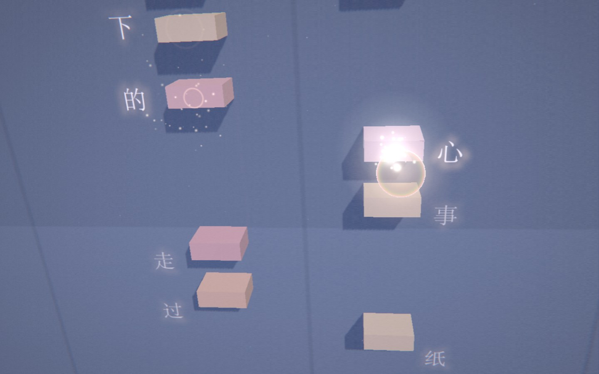

# 流光琴键 · Lumen Keys

给 **Folia** 的歌词动画模组：一面**立体墙面**。琴键是长方体，背面固定在墙上、朝观众伸出来；玻璃球是有质量的刚体，沿看不见的轨迹下落，撞到琴键时把键压得绕固定边**震动**，自己被弹开、被压扁，墙上留下影子。

- 只注册一个 **歌词动画模式**（`visualizers`），不需要任何权限，不改 Folia 本体
- 琴键分组跟着 Folia 正在播放的音频（中高频 spectral flux 检测旋律 onset）
- 轨迹不渲染；只有墙、琴键、字和球
- 纯渲染端：没有 main 入口、不联网



## 安装

把 `lumen-keys` 文件夹放进 `%APPDATA%\Folia\mods`，或把 `lumen-keys.zip` 拖进 Folia 的模组面板，然后在 设置 → 模组 里启用（需要打开「社区模组」）。

## 使用

播放页 → 歌词样式选择器 → **流光琴键**。设置 → 模组 可调配色、辉光、字号、镜头漂移、音频反应。

## 它怎么工作

- **空间**：一面竖直墙（带拼缝和噪点），斜向透视的相机，一盏投影方向光；琴键在墙上投下影子。
- **琴键**：`1.1 × 0.42 × 0.78` 的长方体，背面贴墙，向 +z 伸出；全部固定朝向，不随轨迹倾斜。
- **震动**：被撞后绕贴墙的那条边做**阻尼弹簧**摆动（俯仰 + 轻微侧滚），同时自发光闪一下；弹簧刚度 150、阻尼 7.5。
- **球**：玻璃刚体，垂直方向用软约束跟随歌曲进度，撞键时获得向上的冲量和反向的横向冲量，再被拉回时间轴；撞击瞬间压扁、回弹。
- **撞击**：火花 + 冲击环 + 白色闪光 + 镜头抖动 + 键的震动 + 球的压扁。
- **分组**：一次旋律 onset 生成 1–3 个键，左右两列；歌词只作为部分键的标签，不保证一键一字。

## 已知限制

- 只在**主窗口的播放页**渲染；OBS 浏览器源不加载模组。
- Folia 只给实时 analyser，不给音频文件/MIDI，所以“旋律”是频谱通量近似的 onset。
- 球是“软约束刚体”：完全自由的刚体会和歌曲进度脱节，所以竖向用弹簧拉回时间轴；如果你要彻底自由落体 + 碰撞，需要另一套同步策略。
- 4K / 核显掉帧时先把「辉光」调低。

## 开发

```powershell
node dev/serve.mjs
# http://127.0.0.1:8787/dev/preview.html?t=8.42
# http://127.0.0.1:8787/dev/preview.html?line=1
```

打包：`node scripts/build.mjs` → `release/lumen-keys/` 与 `release/lumen-keys.zip`。

## 许可

MIT。three.js 为 MIT，见 `vendor/`。
